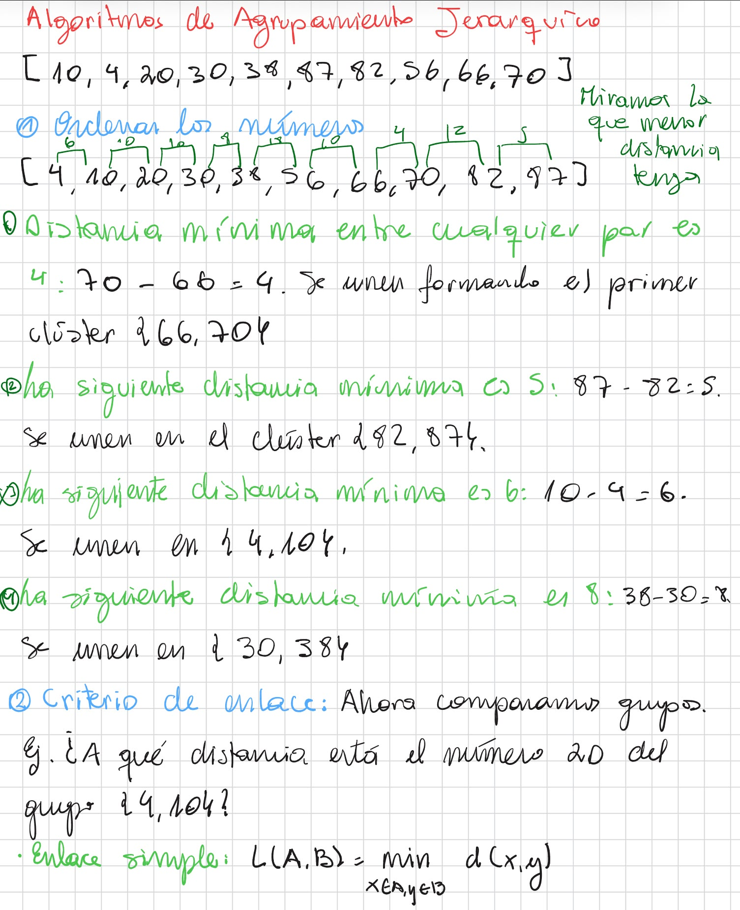
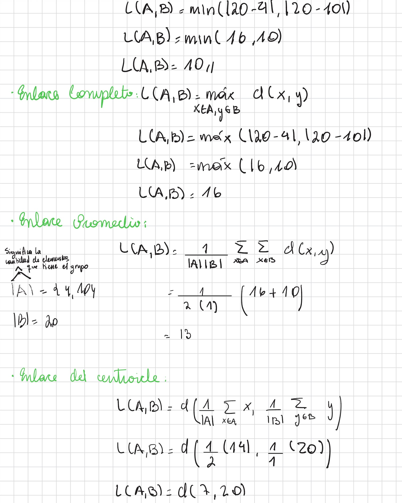
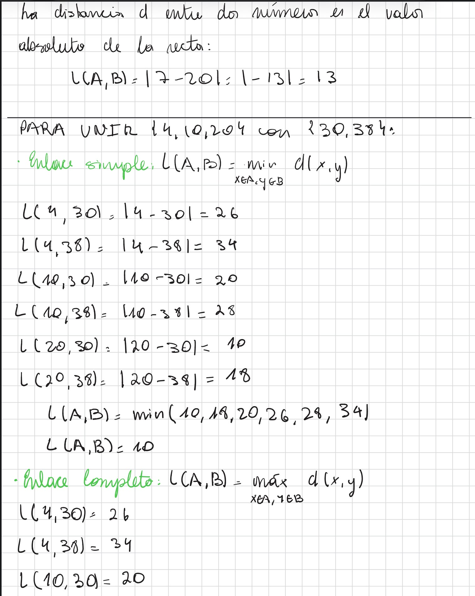
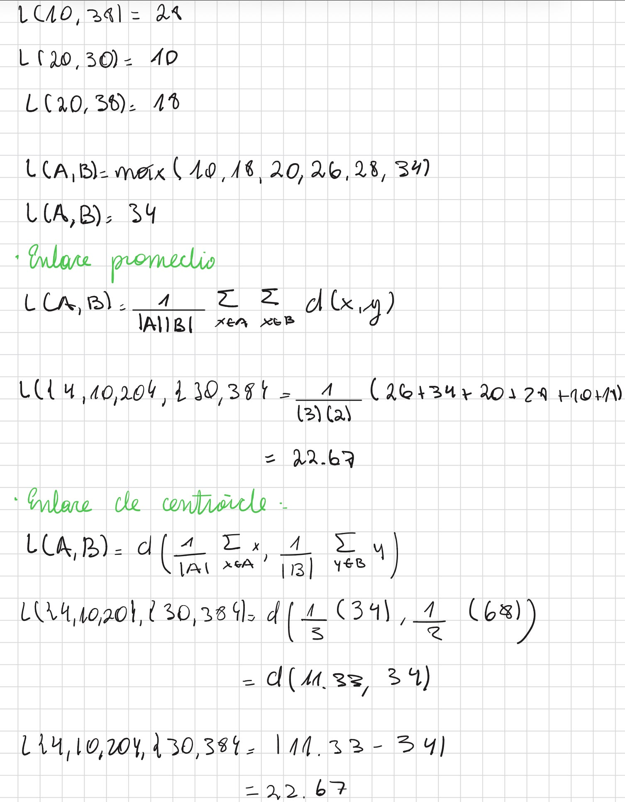

## Algoritmos de Agrupamiento Jerárquico

¿Qué pasa si a veces quieres agrupar tus datos en 2 grandes categorías («Pokémon Legendarios vs. Comunes») y otras veces en 18 tipos específicos? A diferencia de K-Means, el agrupamiento jerárquico no te obliga a elegir el número de clústeres desde el principio; en su lugar, construye un árbol completo de relaciones (llamado dendrograma) que puedes «cortar» a la altura o nivel de detalle que desees después de ver los datos.

## Algoritmo Aglomerativo vs Algoritmo Divisivo

- **Algoritmo Aglomerativo (AHC - Bottom-Up / De abajo hacia arriba):** Es el más común. Empieza tratando a cada dato individual como su propio clúster ($C_0 \leftarrow D$). En cada paso, busca el par de clústeres $c_i, c_j$ cuya distancia $L(c_i, c_j)$ sea **mínima**, los fusiona en uno nuevo ($c_* \leftarrow c_i \cup c_j$) y repite el proceso hasta que todos los datos quedan unidos en un único gran clúster (`mientras |C_l| > 1`).

- **Algoritmo Divisivo (DHC - Top-Down / De arriba hacia abajo):** Hace exactamente lo inverso. Empieza con todos los datos metidos en un solo clúster gigante ($C_0 \leftarrow \{D\}$) y, en cada paso, selecciona un clúster y lo divide en subclústeres más pequeños ($c_1, c_2, \dots, c_k$) hasta que cada dato queda aislado.

## Criterios de enlace(¿Cómo medimos la distancia entre grupos?)

Cuando un clúster ya tiene varios puntos adentro, necesitamos una **función de enlace** $L(A, B)$ para medir la distancia entre el clúster $A$ y el clúster $B$ a partir de la distancia $d(x, y)$ entre sus puntos individuales:

- **Enlace simple (_Single linkage_):** Toma la **distancia mínima** (los dos puntos más cercanos entre ambos grupos):

$$L(A, B) = \min_{x \in A, y \in B} d(x, y)$$

- **Enlace completo (_Complete linkage_):** Toma la **distancia máxima** (los dos puntos más lejanos entre ambos grupos):

$$L(A, B) = \max_{x \in A, y \in B} d(x, y)$$

- **Enlace promedio (_Average linkage_):** Calcula el **promedio** de todas las distancias posibles entre cada punto de $A$ y cada punto de $B$:

$$L(A, B) = \frac{1}{|A||B|} \sum_{x \in A} \sum_{y \in B} d(x, y)$$

- **Enlace de centroide (_Centroid linkage_):** Calcula primero el punto promedio (centroide) de $A$ y el centroide de $B$, y mide la distancia entre ambos centros:

$$L(A, B) = d\left(\frac{1}{|A|} \sum_{x \in A} x, \frac{1}{|B|} \sum_{y \in B} y\right)$$

### Ejercicio en clase

### Preguntas tipo entrevista de la guía
- Pregunta 1 (El problema del clúster gigante con enlace simple): Si aplicas enlace simple y obtienes un clúster gigante que absorbe casi todos los datos, estás sufriendo el efecto de encadenamiento (chaining effect). Como el enlace simple solo mira el par de puntos más cercano, basta con que haya una fila de puntos intermedios («puentes» o ruido) para que dos grupos distintos se unan en una larga cadena. Solución: Cambiar a enlace completo (que fuerza a que los clústeres sean compactos y esféricos al medir el punto más lejano) o enlace promedio.  

- Pregunta 2 (Ventajas del método divisivo sobre el aglomerativo): Si solo necesitas dividir tus datos en unos pocos clústeres grandes (por ejemplo, 2 o 3 grupos), el divisivo es computacionalmente más eficiente porque puedes detenerlo tras 1 o 2 divisiones sin calcular todo el árbol hasta las hojas individuales; además, suele producir mejores particiones globales porque toma decisiones viendo la estructura completa del dataset desde el inicio, mientras que el aglomerativo toma decisiones locales irreversibles paso a paso