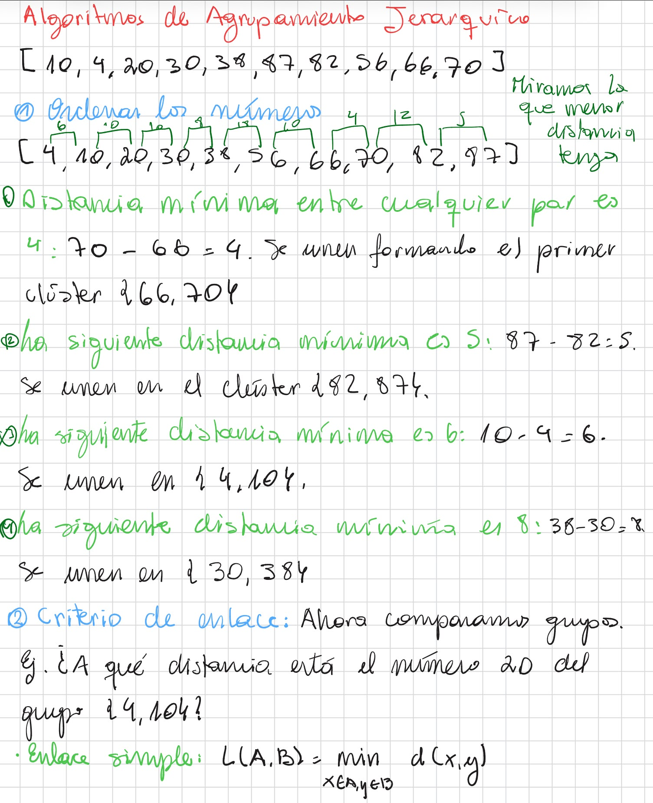
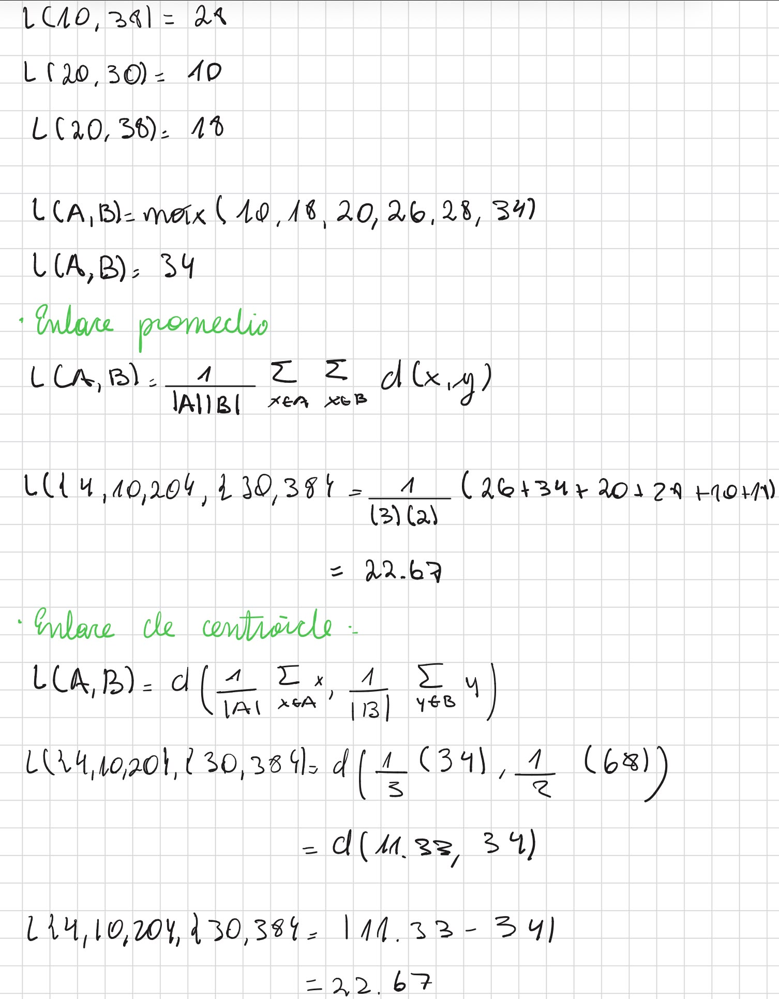

## Algoritmos de Agrupamiento Jerárquico

¿Qué pasa si a veces quieres agrupar tus datos en 2 grandes categorías («Pokémon Legendarios vs. Comunes») y otras veces en 18 tipos específicos? A diferencia de K-Means, el agrupamiento jerárquico no te obliga a elegir el número de clústeres desde el principio; en su lugar, construye un árbol completo de relaciones (llamado dendrograma) que puedes «cortar» a la altura o nivel de detalle que desees después de ver los datos.

## Algoritmo Aglomerativo vs Algoritmo Divisivo

- **Algoritmo Aglomerativo (AHC - Bottom-Up / De abajo hacia arriba):** Es el más común. Empieza tratando a cada dato individual como su propio clúster ($C_0 \leftarrow D$). En cada paso, busca el par de clústeres $c_i, c_j$ cuya distancia $L(c_i, c_j)$ sea **mínima**, los fusiona en uno nuevo ($c_* \leftarrow c_i \cup c_j$) y repite el proceso hasta que todos los datos quedan unidos en un único gran clúster (`mientras |C_l| > 1`).

- **Algoritmo Divisivo (DHC - Top-Down / De arriba hacia abajo):** Hace exactamente lo inverso. Empieza con todos los datos metidos en un solo clúster gigante ($C_0 \leftarrow \{D\}$) y, en cada paso, selecciona un clúster y lo divide en subclústeres más pequeños ($c_1, c_2, \dots, c_k$) hasta que cada dato queda aislado.

## Criterios de enlace(¿Cómo medimos la distancia entre grupos?)

Cuando un clúster ya tiene varios puntos adentro, necesitamos una **función de enlace** $L(A, B)$ para medir la distancia entre el clúster $A$ y el clúster $B$ a partir de la distancia $d(x, y)$ entre sus puntos individuales:

- **Enlace simple (_Single linkage_):** Toma la **distancia mínima** (los dos puntos más cercanos entre ambos grupos):

$$L(A, B) = \min_{x \in A, y \in B} d(x, y)$$

- **Enlace completo (_Complete linkage_):** Toma la **distancia máxima** (los dos puntos más lejanos entre ambos grupos):

$$L(A, B) = \max_{x \in A, y \in B} d(x, y)$$

- **Enlace promedio (_Average linkage_):** Calcula el **promedio** de todas las distancias posibles entre cada punto de $A$ y cada punto de $B$:

$$L(A, B) = \frac{1}{|A||B|} \sum_{x \in A} \sum_{y \in B} d(x, y)$$

- **Enlace de centroide (_Centroid linkage_):** Calcula primero el punto promedio (centroide) de $A$ y el centroide de $B$, y mide la distancia entre ambos centros:

$$L(A, B) = d\left(\frac{1}{|A|} \sum_{x \in A} x, \frac{1}{|B|} \sum_{y \in B} y\right)$$

### Ejercicio en clase

## Preguntas de Cierre
**Verificación de aprendizaje**
1. En el ejercicio manual, ¿qué pasos seguiría el método aglomerativo y en qué sentido cambiaría el procedimiento si fuera divisivo?
    - Método aglomerativo (De abajo hacia arriba / *Bottom-Up*): Inicia tratando cada número de la lista como un clúster individual ($C_0 \leftarrow D$). En cada paso busca el par de clústeres $c_i, c_j$ cuya distancia de enlace $L(c_i, c_j)$ sea mínima, los fusiona en un nuevo grupo ($c_* \leftarrow c_i \cup c_j$) y actualiza las distancias hasta que todos los números quedan unidos en un único gran clúster.

    - Cambio en el método divisivo (De arriba hacia abajo / *Top-Down*): Sigue la dirección inversa: empieza con todos los números dentro de un único clúster global ($C_0 \leftarrow \{D\}$) y, en cada iteración, selecciona un clúster y lo divide sucesivamente en subclústeres más pequeños ($c_1, \dots, c_k$) hasta separar los datos.

2. ¿Qué indican la distancia de una fusión y un corte del dendrograma a una distancia determinada?
    - Distancia de una fusión (altura en el eje vertical): Indica el valor exacto de la función de enlace $L(A, B)$ al que dos clústeres se unieron; mientras mayor es la altura del puente, más diferentes (distantes) eran los grupos fusionados.   
    - Corte del dendrograma a una distancia determinada: Trazar una línea horizontal a una altura específica detiene las fusiones por encima de ese umbral y define los grupos finales; la cantidad de líneas verticales que atraviesa el corte indica el número de clústeres resultantes.

3. ¿Por qué pueden cambiar las fusiones al pasar de enlace simple a completo con los mismos datos y la misma distancia entre puntos?
Porque cambia la regla matemática para medir la distancia entre grupos que ya tienen más de un elemento:
    - Enlace simple ($\min$): Se fija únicamente en los dos puntos más cercanos entre ambos grupos, por lo que une rápidamente grupos cuyos bordes estén próximos aunque sus extremos opuestos estén muy lejos
    - Enlace completo ($\max$): Se fija en los dos puntos más alejados entre ambos grupos. Esto penaliza los grupos alargados y hace que un punto prefiera unirse a un grupo donde todos sus miembros estén cerca, cambiando el orden en que se fusionan los clústeres.

**Preguntas de entrevista**
1. Tienes un dataset de clientes con múltiples características. Aplicaste clustering jerárquico con enlace simple y obtuviste un cluster gigante con casi todos los datos. ¿Qué problema está ocurriendo y cómo lo resolverías?
    - Tienes un dataset de clientes con múltiples características. Aplicaste clustering jerárquico con enlace simple y obtuviste un cluster gigante con casi todos los datos. ¿Qué problema está ocurriendo y cómo lo resolverías?
    - Cómo resolverlo: Cambiar el criterio a enlace completo (complete) o enlace promedio (average), los cuales exigen que todos los puntos (o su promedio) estén cercanos para fusionarse, produciendo clústeres más compactos y equilibrados (además de verificar que las características estén correctamente estandarizadas).

2. Si quisieras dividir primero un grupo grande, ¿qué decisión adicional exige el enfoque divisivo y por qué no puede suponerse que será más rápido o producirá mejores grupos?
   - Decisión adicional que exige: A diferencia del aglomerativo (que solo busca el mínimo en una matriz de distancias), el divisivo exige decidir qué clúster dividir en cada paso y cómo partirlo óptimamente en subclústeres ($c_1, \dots, c_k$), lo que requiere ejecutar un algoritmo de partición adicional (como $k$-Means o bisección) dentro de cada división.

   - Por qué no siempre es más rápido ni mejor: Evaluar todas las formas posibles de dividir un grupo grande de $N$ elementos en dos ($2^{N-1} - 1$ combinaciones posibles) es computacionalmente muy costoso si no se usan heurísticas aproximadas; además, al igual que el aglomerativo, es un algoritmo voraz (*greedy*): si toma una mala división en el primer corte, ese error no se puede corregir en los niveles inferiores y arrastrará grupos de menor calidad.
    